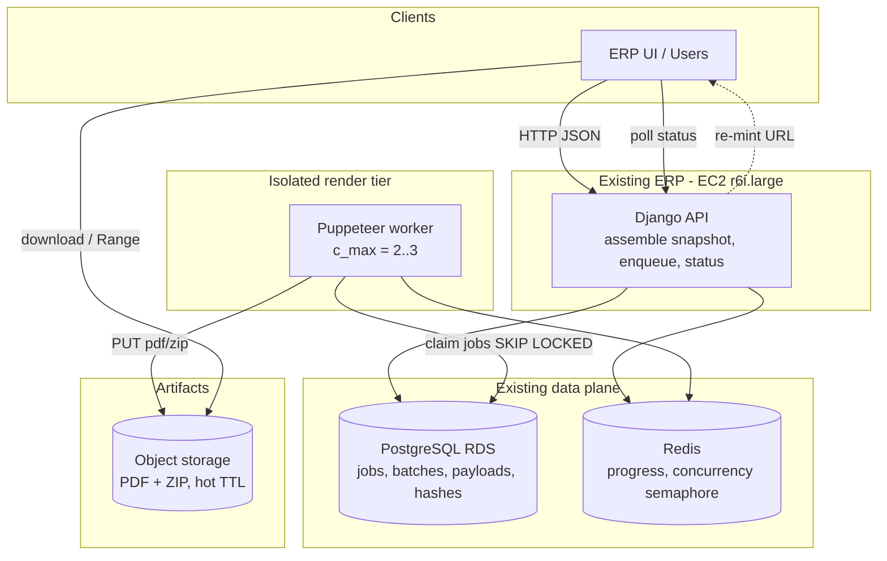
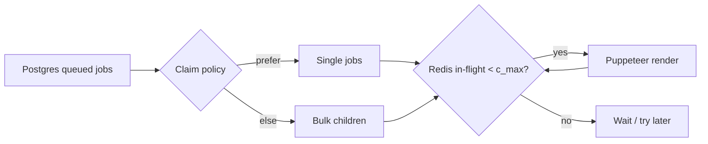
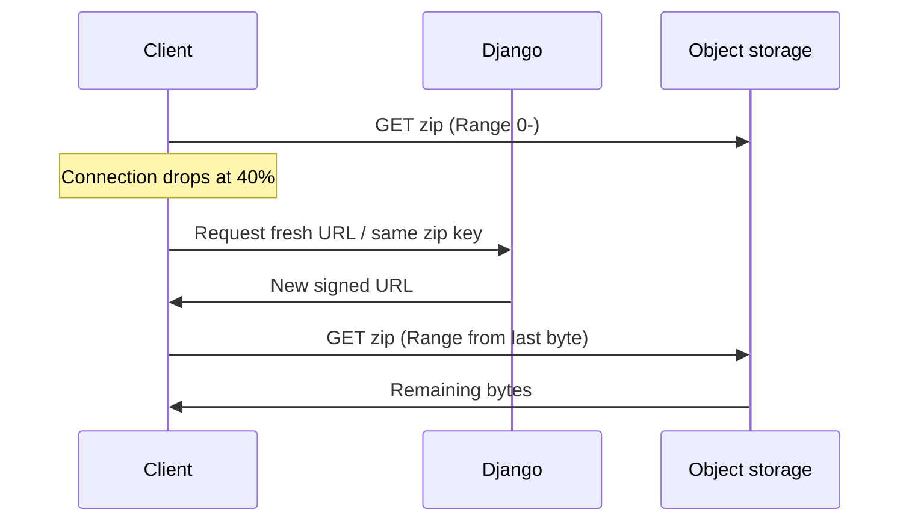
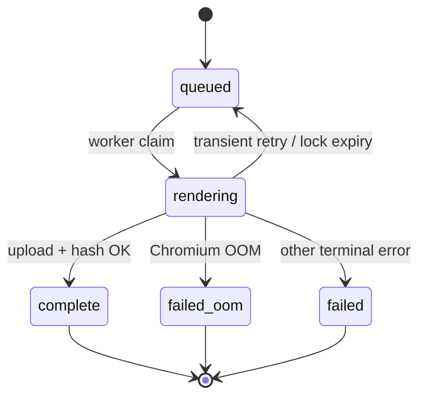

# Design — PDF Generation Microservice (TranZact)

**Chosen approach:** Hybrid request handling (singles prioritised, bulk async) + snapshot payloads at accept, on a lean stack: Django + PostgreSQL + Redis + one isolated Puppeteer worker + object storage.

This design is sized for the **₹12,500/month** budget and **~30,000 PDFs/month** cost profile. Peak **~1000 singles/min** is handled with **queueing and admission control**, not by running dozens of Chromium processes around the clock.

**Diagram artefacts (match `APPROACH.md`):** `architecture-diagram.png` · `architecture-diagram.svg`

---

## 1. Architecture diagram



**Interview one-liner:** *Django never runs Chromium; it freezes data and records jobs. A small capped worker renders. Bytes live in object storage so flaky downloads retry without regenerating.*

---

## 2. Core components (what each owns)

| Component | Responsibility |
|-----------|----------------|
| **Django** | Auth (existing), build/accept **snapshot JSON**, create jobs, admission control, status APIs, trigger zip when batch ready |
| **PostgreSQL** | Source of truth for job/batch state, frozen payloads, idempotency keys, content hashes / HMAC |
| **Redis** | Fast progress counters, global in-flight semaphore (how many Puppeteer jobs may run) |
| **Worker** | Claim work, render HTML→PDF with Puppeteer, upload artifacts, mark success/failure |
| **Object storage** | Durable PDF/ZIP bytes with lifecycle (hot TTL); supports ranged/resumable GET where available |

---

## 3. End-to-end: single PDF

**Goal:** When the worker is free, aim for downloadable bytes in ~**5 seconds** (render is already 2–3 s). When busy, accept fast with `202` and let the client poll — do not pile unbounded Chromiums onto the box.

```
Client                    Django                      Postgres/Redis         Worker              Object store
  |                         |                              |                   |                     |
  |-- POST /pdf/single ---->|                              |                   |                     |
  |   snapshot JSON +       |-- insert job (queued) ------>|                   |                     |
  |   idempotency_key       |-- check semaphore ----------->|                   |                     |
  |                         |                              |                   |                     |
  |         [slot free]     |                              |                   |                     |
  |                         |-- signal / worker polls -----|------------------>|                     |
  |                         |                              |<-- claim job -----|                     |
  |                         |                              |                   |-- Puppeteer PDF --->|
  |                         |                              |                   |-- PUT pdf/{id} ---->|
  |                         |                              |<-- complete+hash -|                     |
  |<-- 200 + download URL --|                              |                   |                     |
  |-- GET pdf (Range OK) ---|------------------------------|-------------------|-------------------->|
  |                         |                              |                   |                     |
  |         [no slot]       |                              |                   |                     |
  |<-- 202 + job_id --------|                              |                   |                     |
  |-- GET /pdf/jobs/{id} -->|-- read status --------------->|                   |                     |
  |<-- complete + URL ------|                              |                   |                     |
```

**Steps in plain language**

1. ERP/UI sends **full document JSON** (not just an invoice id) plus an **idempotency key**.
2. Django writes a `pdf_jobs` row: payload, `status=queued`, type=`single`.
3. If Redis says in-flight &lt; `c_max` **and** the single lane is allowed, the worker claims the job and renders.
4. On success: upload `pdf/{job_id}.pdf`, store **SHA-256** (and optional HMAC) in Postgres, set `status=complete`.
5. Client downloads from object storage (or via a short-lived URL Django mints). **Re-download does not re-render.**
6. If the system is overloaded (queue wait estimate too high): respond **429/503 + Retry-After** instead of accepting infinite work.

**Why interviewers like this:** You separate “accept the request” from “burn 400 MB of RAM,” and you have a clear story when peak hits.

---

## 4. End-to-end: bulk → progress → ZIP

**Goal:** Up to **100** PDFs, **progress updates**, ZIP (and/or per-file) download, no 100 parallel browsers, stable data for the whole batch.

```
Client          Django              Postgres                Worker(s)           Object store
  |               |                     |                      |                     |
  |-- POST /bulk->|                     |                      |                     |
  |  N snapshots  |-- batch + N jobs -->|                      |                     |
  |<-- 202 batch--|                     |                      |                     |
  |               |                     |<-- claim child ------|                     |
  |               |                     |                      |-- PUT pdf --------->|
  |               |                     |<-- child complete ---|                     |
  |-- poll ------->|-- done/total ------|                      |                     |
  |<-- progress --|                     |                      |                     |
  |               |  (all terminal)     |                      |                     |
  |               |-- enqueue zip job ->|                      |-- build ZIP ------->|
  |               |                     |                      |-- PUT zip --------->|
  |-- GET zip ----|---------------------|----------------------|-------------------->|
  |  or per-PDF   |                     |                      |                     |
```

**Steps in plain language**

1. Client sends **up to 100 snapshot documents** in one request (all frozen at the same accept moment).
2. Django creates one `pdf_batches` row and **N child** `pdf_jobs` (each with its own payload copy). Returns **`202` + `batch_id` immediately**.
3. Workers pull **one child at a time** (subject to global `c_max` and **single-job priority**). Never `Promise.all` 100 Puppeteer runs.
4. After each child: update `done/total` (Redis + Postgres). Client polls `GET /pdf/batches/{id}`.
5. When children are terminal, a **zip job** streams/packs existing PDF objects into `zip/{batch_id}.zip` (or builds on demand).
6. Client downloads the ZIP **and/or** individual PDFs. Mid-transfer failure → retry GET / use **Range** — still no re-render if objects exist.

**Partial success:** If one child OOMs, mark that child `failed_oom`; batch can finish as `partial_success` with the rest downloadable. That is “graceful,” not “pretend it worked.”

---

## 5. Worker concurrency

**Problem:** Each PDF holds ~**400 MB** for **2–3 s**. Unbounded parallelism OOMs the machine. Sustaining 1000/min would need ~33–50 in-flight renders on average — incompatible with a **₹12,500** lean deploy. We cap hard and prioritise.

| Rule | Value / behaviour |
|------|-------------------|
| Global cap | `c_max = 2`–`3` in-flight Puppeteer jobs on the worker (raise only after measuring RSS) |
| Enforcement | Redis semaphore (or worker-local pool + DB claim); claim only if slot acquired |
| Priority | Prefer `type=single` over bulk children when claiming |
| Bulk | Children serialize through the same small pool — wall-clock longer, memory safe |
| Isolation | Worker process/host **separate** from Django’s 16 GB ERP box |

**Interview line:** *Concurrency is a memory budget, not a throughput wish. Hybrid means singles jump the queue; bulk fills idle slots.*



---

## 6. Queue, claims, and retries

**Queue = PostgreSQL rows**, not a separate broker (enough at ~30k PDFs/month; less ops).

**Claim pattern (conceptually):**

```sql
-- worker transaction
SELECT id FROM pdf_jobs
WHERE status = 'queued'
ORDER BY (type = 'single') DESC, created_at ASC
FOR UPDATE SKIP LOCKED
LIMIT 1;
-- set status = 'rendering', locked_by = worker_id, locked_at = now()
```

### Retry policy

| Failure class | Action | Why |
|---------------|--------|-----|
| Transient (network blip to object store, worker kill mid-job) | Retry up to **N** (e.g. 2–3) with backoff; same `job_id` | At-least-once delivery is OK if effects are idempotent |
| **OOM / known poison** (large table crash) | **No** endless retry → `failed_oom` | Retries multiply memory pressure |
| Logic / bad template | `failed` terminal | Fix data/template; don’t burn CPU |
| Duplicate enqueue (same idempotency key) | Return existing job | Prevents double PDF / double cost |

### Idempotency (critical for retries)

1. Object key is deterministic: `pdf/{job_id}.pdf`.
2. Mark `complete` **only after** upload succeeds and hash is written.
3. If worker dies after upload but before DB update: retry sees object exists (or re-uploads same key) and then sets `complete` — **one logical artifact**.
4. Progress counters use “transition to complete once” (not +1 on every attempt).

**Stale lock recovery:** If `status=rendering` and `locked_at` older than visibility timeout (e.g. 2–3× max render time), another worker may reclaim. Same idempotent complete path applies.

---

## 7. Large-document OOM handling (500+ line items)

Assignment fact: **500+** line items often crash Puppeteer mid-render.

**Design response (graceful, not magical):**

1. **Preflight:** If `line_item_count` (from snapshot) ≥ threshold (e.g. 500), optionally run with **stricter isolation** (only 1 heavy job at a time) or fail fast with a clear error if product prefers.
2. **Detect crash:** Worker/child exit, cgroup OOM, or Puppeteer disconnect → classify as `oom` when RSS was high / exit code indicates kill.
3. **Terminal status:** `failed_oom` with message for UI (“Document too large to render; split or contact support”).
4. **Do not** auto-retry the same HTML 10 times.
5. Bulk continues other children; user still gets a ZIP of successes + list of failures.

**Interview line:** *Graceful means detectable, bounded, and user-visible — not “retry until the host dies.”*

---

## 8. Resumable / reliable downloads (flaky SMB links)

**Problem:** Bulk downloads of **50+** PDFs often fail midway.

**Design:**

| Mechanism | Detail |
|-----------|--------|
| Durable objects | Each PDF stored before batch is “ready” |
| Per-PDF URLs | Client can fetch files individually if ZIP fails |
| ZIP from objects | Rebuild ZIP without re-rendering |
| HTTP **Range** | Prefer object storage / proxy that supports `Range` so clients resume byte offsets |
| Re-mintable URLs | Signed URL expiry ≠ object deletion; Django can issue a new URL |
| Hot TTL | Keep artifacts long enough for retries (days, not forever — budget) |
| Never “download fail ⇒ regenerate” | Only regenerate if object expired/missing |



---

## 9. Consistent bulk data snapshots

**Problem:** ERP data changed before the **87th** PDF (~**3 minutes** later) → mixed/stale GST documents.

**Rule:** The PDF service is a **pure renderer**. At `POST /bulk` (and `/single`), Django sends **complete snapshot JSON** for every document. Workers **never** re-query live invoice rows during the batch.

| Property | Guarantee |
|----------|-----------|
| Within one batch | All PDFs reflect data as of **accept time** |
| After user edits | Edits **after** click do not appear (by design) |
| Evidence | Optional `snapshot_hash` / `accepted_at` stored on the batch |

**Why not live fetch:** Live fetch maximises “freshness” but creates **inconsistent sets** — worse for compliance packs.

---

## 10. Tamper evidence (without overcomplicating)

**Goal:** Prove a PDF was **not modified after generation**.

**Practical scheme:**

1. After successful render, compute **SHA-256** of the PDF bytes.
2. Store hash in **PostgreSQL** (separate trust domain from the object bytes when IAM differs).
3. Optionally store **HMAC-SHA256(hash, server_secret)** so a storage-only attacker who rewrites the object but not the DB row (or cannot forge HMAC) fails verification.
4. Compliance UI: “Verify” recomputes file hash and compares to Postgres (and checks HMAC).

**What we do *not* need for v1:** Full PKI, blockchain, or client certificates.

**Honest limit:** If an attacker controls **both** object storage **and** the Postgres row/secret, they can lie. Split custody + HMAC is enough for “don’t overcomplicate” while beating a `.sha256` sidecar next to the file.

---

## 11. Failure recovery matrix

| What fails | What the user sees | System behaviour |
|------------|--------------------|------------------|
| **Worker crash** mid-render | Job stays `rendering` then returns to `queued` or fails after timeout | Lock expiry → reclaim; idempotent upload |
| **Worker crash** after upload, before DB complete | Brief “processing” then `complete` | Retry finds object / re-PUT same key → mark complete |
| **Postgres** briefly down | API errors; no silent half-writes | No job accept without durable insert |
| **Redis** down | Degrade: concurrency may fall back to conservative local cap; progress from Postgres | Don’t use Redis as sole job store |
| **Object storage** error | Job retries then `failed_storage` | Status never `complete` without verified bytes |
| **Client disconnect** mid-ZIP | Download fails | Re-GET / Range; artifacts remain |
| **Overload** (≪ 1000/min capacity) | 429/503 or 202+wait | Admission control; shed bulk first |
| **OOM on huge PO** | That doc failed; others OK | `failed_oom`; no retry storm |

---

## 12. Job state machine (keep it small)



Batch status rolls up: `queued` → `running` → `complete` | `partial_success` | `failed`.

---

## 13. How this meets the assignment (defence cheat-sheet)

| Requirement | Design answer |
|-------------|----------------|
| Puppeteer + HTML templates | Worker-only Chromium |
| Single + bulk (≤100) + ZIP | Hybrid flows above |
| Concurrent efficiently | Hard `c_max`, priority lanes |
| ~1000/min peak | Queue + admit; not 50 browsers always-on under ₹12,500 |
| ~400 MB / 2–3 s | Cap concurrency from memory math |
| Progress on bulk | Redis/Postgres `done/total` |
| Unreliable downloads | Objects + Range + per-PDF + re-mint URL |
| Bulk consistency | Snapshot JSON at accept |
| Tamper evidence | SHA-256 (+ optional HMAC) in Postgres |
| Don’t re-architect monolith | Django stays edge; additive tables/endpoints |
| Budget | One small worker + storage TTL; reuse RDS/Redis |

---

## 14. Explicit non-claims (say this in the interview)

- We do **not** claim every single at peak gets PDF bytes in 5 s while running only 2–3 concurrent Chromiums — physics forbids it; we claim **priority + honesty under overload**.
- A queue **does not** create capacity; it protects memory and ERP uptime.
- “Graceful” OOM means **controlled failure**, not a guaranteed render of every 500+ line monster without product limits.

---

*Companion docs: `ARCHITECTURE_OPTIONS.md` (why this beat A/B), `CAPACITY_MATH.md` (numbers), `CRITICAL_ENGINEERING_REVIEW.md` (risks).*
